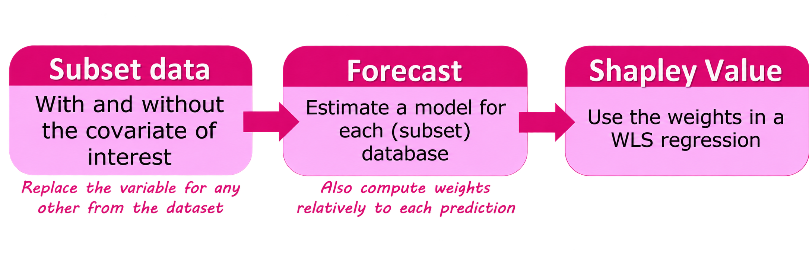

<!--
Choose Knit to PDF or Knit to Slidy in RStudio's Knit menu.
To render both from the repository root:
rmarkdown::render("example Rmarkdown/split-example.rmd", output_format = "all")

Add {.split} to a slide heading. Write the left column, add the divider
on its own line with blank lines around it, then write the right column.
The next ## heading ends both columns. No closing markers are needed.
Both sides accept ordinary Markdown and R chunk output.

For another HTML format, such as Reveal.js, include
--lua-filter=cpb-split.lua in that output's pandoc_args too.
HTML uses the selected HTML theme; the CPB .sty applies to PDF only.
-->

## My slide {.split}

- First point
- Second point
    - A nested point

<!-- right -->

## Another slide

- Back to a normal full-width slide.
- Start another two-column slide by adding `{.split}` to its heading.

## A block

> [!BLOCK] Task
>
> - First point
> - Second point with **bold text**

This text is outside the block.

## A diagram

> [!DIAGRAM] blue {width=80%}
>
> | Box   | Text   | Caption   |
> |-------|--------|-----------|
> | Box 1 | Text 1 | Caption 1 |
> | Box 2 | Text 2 | Caption 2 |
> | Box 3 | Text 3 |           |
>
> Example of a blue diagram